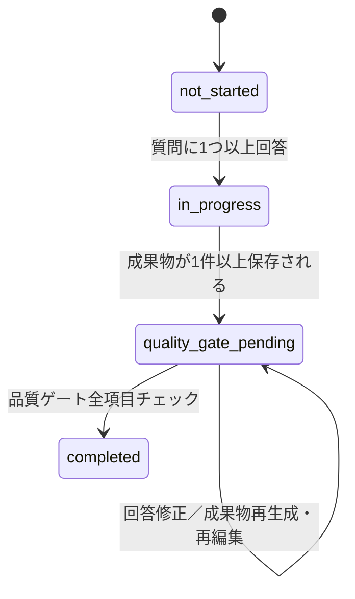

# 状態値（status／mode系）の定義

以下の値は、DB・API・フロントで共通して使う語彙として固定する（`docs/README.md` C2.0）。

| 項目                                                              | 型   | 値                     | 意味                                                     |
| ----------------------------------------------------------------- | ---- | ---------------------- | -------------------------------------------------------- |
| `project_stages.status`                                           | ENUM | `not_started`          | 質問未回答の状態                                         |
|                                                                   |      | `in_progress`          | 質問回答中〜成果物未生成                                 |
|                                                                   |      | `quality_gate_pending` | 成果物は生成済みだが、品質ゲート未通過                   |
|                                                                   |      | `completed`            | 品質ゲート通過済み。次工程へ進行可能                     |
| `projects.overall_status`                                         | ENUM | `in_progress`          | いずれかの工程が`completed`未満                          |
|                                                                   |      | `completed`            | 工程7（ドキュメント）まで`completed`                     |
| `execution_mode`（UI選択・`execute`呼び出しの前提）               | ENUM | `prompt_only`          | プロンプトのみ出力し、外部で生成した結果を後で貼り付ける |
|                                                                   |      | `ai_executed`          | アプリ内でClaude APIを呼び出し、そのまま成果物を生成する |
| `deliverables.generation_method`（保存された成果物1件ごとの記録） | ENUM | `manual`               | `prompt_only`で進めた場合の貼り付け・手動編集による保存  |
|                                                                   |      | `ai_executed`          | `/execute`エンドポイント経由でAI生成された保存           |
| `users.role`                                                      | ENUM | `user`                 | 案件を進める一般利用者                                   |
|                                                                   |      | `admin`                | マイテンプレートの編集も可能な管理者                     |
|                                                                   |      | `system_admin`         | `admin`の権限を包含し、会社管理画面にもアクセスできる上位ロール |
| `users.status`                                                    | ENUM | `active`               | ログイン可能                                             |
|                                                                   |      | `disabled`             | 無効化済み（退職者等）                                   |
| `organizations.status`                                            | ENUM | `active`               | ログイン・利用可能                                       |
|                                                                   |      | `suspended`            | 無効化済み（この会社に属する全ユーザーがログイン不可になる） |

## 状態遷移ルール（project_stages.status）

`quality_gate_pending`の間は、回答の修正・成果物の再生成・再編集がいつでも可能（品質ゲートを再度満たせば`completed`に進める）。

## `execution_mode`の扱いについての補足

`execution_mode`はAPIリクエストのパラメータとしては送信しない。UI上でユーザーが選んだ結果に応じて、後続で呼び出すエンドポイントが変わるだけである。

- `ai_executed`を選んだ場合：[`POST /execute`](./stages/execute.md)を呼ぶ
- `prompt_only`を選んだ場合：ユーザーが外部で生成した内容を[`PATCH /deliverable`](./stages/update-deliverable.md)で送る

つまり`execution_mode`はフロントエンドの状態管理上の概念であり、サーバー側は関知しない。
