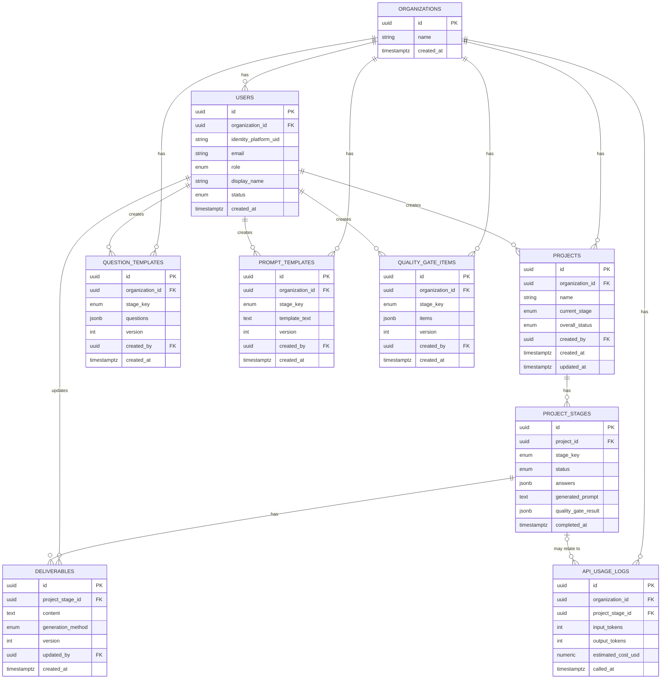

# DB

[API](../api/index.md)の設計（`docs/README.md` B6/C2）から導かれたテーブル構成。詳細なカラム定義は[テーブル定義](./tables.md)を参照。まだ実装はなく、実装しながら見直される想定（`docs/README.md` B7）。

版管理が必要なテーブル（`deliverables` / `question_templates` / `prompt_templates` / `quality_gate_items`）は、更新のたびに新しい行を追加する**追記型（Append-only）**とし、`version`の最大値が「現在有効な版」となる設計にする。

## ER図

