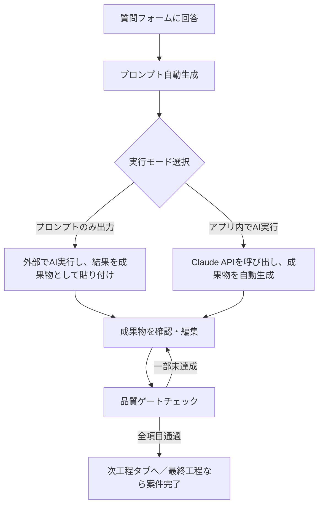

# 案件詳細画面（工程別ワークスペース）

- **URL**: `/projects/[projectId]`
- **画面ファイル**: `app/src/app/(dashboard)/projects/[projectId]/page.tsx`
- **コンポーネント**: `app/src/features/stages/components/StageWorkspace.tsx`

## 概要

7工程（要件定義・設計・実装・レビュー・セキュリティ・テスト・ドキュメント）をタブで切り替えながら、質問への回答→プロンプト生成→実行モード選択→成果物確認→品質ゲート判定、という一連の流れを進める画面。全画面の中で最も操作が多い中心的な画面。

## 主要コンポーネント

`docs/README.md` C3を参照。

| コンポーネント         | 役割                                                     |
| ---------------------- | -------------------------------------------------------- |
| `StageTabBar`          | 7工程タブ。完了済み／現在地／未着手をステータス色分け    |
| `StageQuestionForm`    | 質問セットを動的にレンダリング                           |
| `PromptPreview`        | 生成プロンプトの表示・コピー機能                         |
| `ExecutionModeToggle`  | 「プロンプト出力のみ」／「アプリ内実行」の切り替え       |
| `DeliverableEditor`    | 成果物の表示・編集（Markdownエディタを想定）             |
| `QualityGateChecklist` | チェック項目一覧。全チェックで「次工程へ」ボタンが活性化 |

## 使用API

| API                                                                                           | 用途                                                 |
| --------------------------------------------------------------------------------------------- | ---------------------------------------------------- |
| [`GET /api/projects/:id/stages/:stageKey`](../api/stages/get-stage.md)                        | 質問・回答・プロンプト・成果物・品質ゲート状況の取得 |
| [`POST /api/projects/:id/stages/:stageKey/answers`](../api/stages/save-answers.md)            | 質問への回答を保存                                   |
| [`POST /api/projects/:id/stages/:stageKey/generate-prompt`](../api/stages/generate-prompt.md) | 回答からプロンプトを生成                             |
| [`POST /api/projects/:id/stages/:stageKey/execute`](../api/stages/execute.md)                 | アプリ内でClaude APIを実行し成果物を生成             |
| [`PATCH /api/projects/:id/stages/:stageKey/deliverable`](../api/stages/update-deliverable.md) | 成果物の貼り付け・編集を保存                         |
| [`POST /api/projects/:id/stages/:stageKey/quality-gate`](../api/stages/quality-gate.md)       | 品質ゲートのチェック結果を送信・通過判定             |

## 画面フロー



`execution_mode`（プロンプトのみ出力／アプリ内実行）はフロントエンドの状態管理上の概念で、APIリクエストのパラメータとしては送信しない。ユーザーの選択に応じて後続で呼び出すエンドポイントが変わるだけ（詳細は[APIの状態値定義](../api/status-values.md)を参照）。

## 状態遷移（project_stages.status）

```
not_started --(質問に1つ以上回答)--> in_progress
in_progress --(成果物が1件以上保存される)--> quality_gate_pending
quality_gate_pending --(品質ゲート全項目チェック)--> completed
```

`quality_gate_pending`の間は、回答の修正・成果物の再生成・再編集がいつでも可能。
